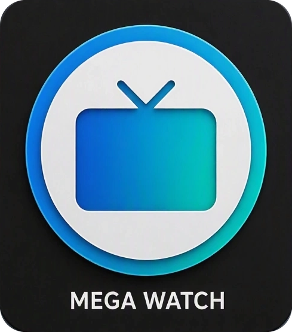

  

<h1 align="center">MegaWatch</h1>

  <strong>The app to watch everything you want.</strong> 
  TV, movies, IPTV and Usenet in one place, with a built-in player.

  <a href="https://github.com/jjrussellite28-art/megawatch/releases">Download</a> •
  <a href="CREDITS.md">Credits</a> •
  <a href="https://github.com/jjrussellite28-art/megawatch/issues">Report a problem</a>

> **MegaWatch** is an independent fork of [Debrify](https://github.com/varunsalian/debrify) by Varun Salian and contributors, used under the AGPL-3.0 licence. It is not made, endorsed or supported by the Debrify project. Full credits, licences and the take-down policy are in [CREDITS.md](CREDITS.md). If you are credited and want something changed or removed, please open an issue and it will be handled promptly.

## What it is

MegaWatch is a personal media hub for Windows (and other Flutter platforms). It brings the services you already use into one app with a cinematic built-in player. It does not provide any content itself.

## What I added to the fork

- **Watch Order and franchise timelines**: what to watch before and next, a full timeline with a "you left off here" marker, finished ticks, "add all to My Watchlist" and "mark everything before this as watched".
- **Universe row** with three orders (related, release date, story) and TV status badges (running, canceled, ended, in development).
- **Debrid safety lock**: torrent search engines only run when a debrid service is connected, and raw-torrent add-on results stay hidden until then.
- **Player safety badge**: shows whether the video is coming through debrid, encrypted (green), a direct https link (blue) or not encrypted (red).
- **Usenet cards**, a hero "Open" button, a trailer play button and a YouTube fallback player.
- **Custom settings page** collecting everything above, an optional player seek lock, no analytics and no remote donation config.

## Install (Windows)

1. Open the [Releases](https://github.com/jjrussellite28-art/megawatch/releases) page and download `megawatch-<version>-setup.exe`.
2. Run it. If Windows says "Windows protected your PC", choose **More info → Run anyway** (the app is not code-signed).
3. In **Settings → Metadata** paste your own free TMDB read-access token, then connect your own debrid service and accounts.

## Safety notes

MegaWatch has no built-in torrent client, so it never connects to other people's computers. Debrid services still see what you request, and sites hosting direct links can see your IP address. Use only content you have the right to watch. This is not legal advice.

## Credits

- [Debrify](https://github.com/varunsalian/debrify), the project this is based on.
- u/demon-myth's public Watch Order Stremio add-on (used through its public API; no code or data bundled).
- Ideas from RobbdeezeNutz's Debrify fork. No code copied.
- TMDB ("This product uses the TMDB API but is not endorsed or certified by TMDB"), Stremio Cinemeta, Trakt, Simkl and MDBList.

## Licence

AGPL-3.0. See [LICENSE](LICENSE). The Debrify name and logo are not used here (see [TRADEMARKS.md](TRADEMARKS.md)).
